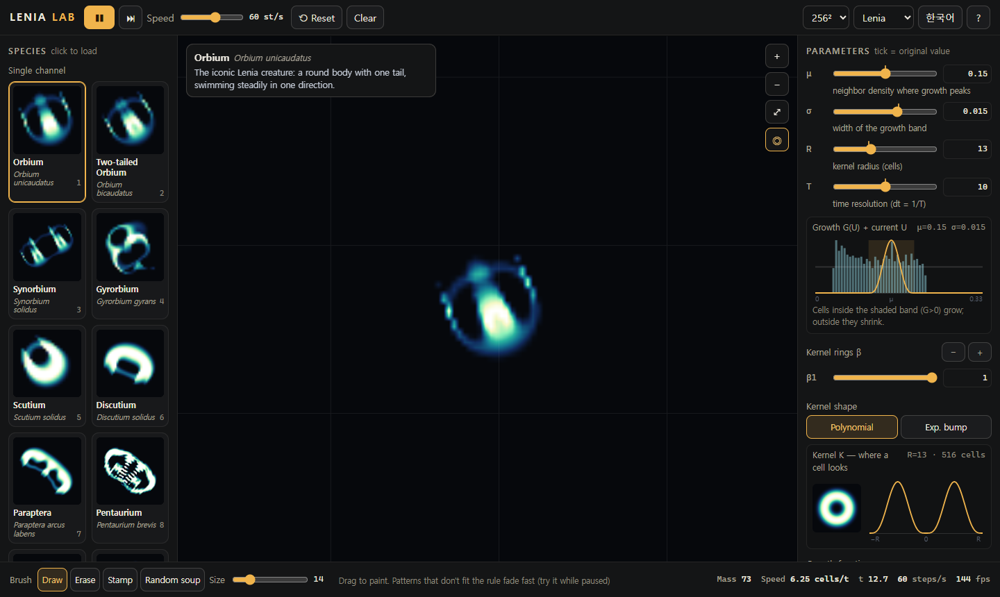
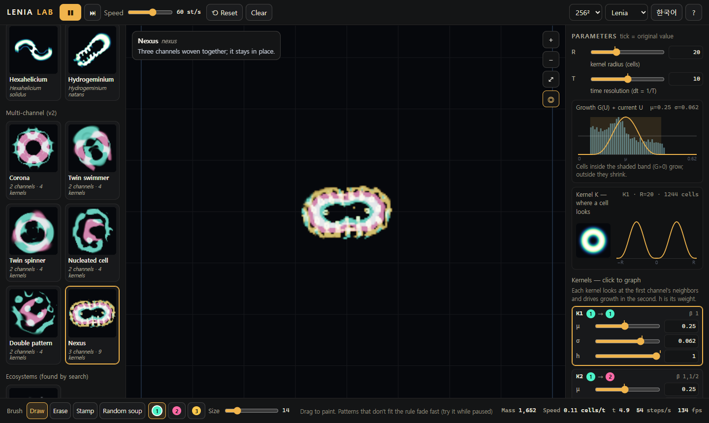

# Lenia Lab

Continuous cellular automata in your browser: creatures that swim, spin and hold their shape, computed live on the GPU.
It is one HTML file with no install and no dependencies.

**Live demo:** https://kraewon7422.github.io/lenia-lab/ · **Run locally:** open `lenia-lab.html` in a recent Chrome, Edge or Safari (double-clicking works). Tests: `lenia-lab.html?test=1`.




## What it does
- **12 single-channel species** from Bert Chan's Lenia catalogue (Orbium, Gyrorbium, Scutium, Pentaurium, Kronium, Hydrogeminium …). Each was checked to stay alive and to move at the same speed as the reference Python implementation.
- **6 multi-channel creatures** (Corona, Twin swimmer, Twin spinner, Nucleated cell, Double pattern, Nexus) from Chan's search results. Channel masses after 200 steps match the reference within 0.1 %.
- **Ecosystem preset**: a symbiotic pair found by an automated search in this project. Territory and predator–prey rules were searched for but not found robustly (see *Ecosystem search*).
- **Discovery mode**: tries random rules on random soup and keeps only creatures that survive **alone** in an empty world. You can save them to *My finds* (stored in your browser).
- **Live parameters**: μ, σ, R, T, kernel rings β, kernel and growth shapes. In multi-channel mode, every kernel has its own μ, σ and h. Each slider marks the species' original value.
- **Graphs** that explain why a creature lives or dies: the kernel profile, the growth function G(U) with the current distribution of U drawn over it, and mass over time (per channel).
- **Brushes**: draw, erase, stamp (drag to aim), random soup. In multi-channel mode you choose which channel to paint.
- **Views**: creature A, neighbor sum U, growth G. Also a follow camera, zoom and pan, and the torus seam shown on screen.
- Share links (all parameters in the URL), PNG export, Korean and English.

## The rule
```
single channel   U = K * A                    A ← clip(A + G(U)/T, 0, 1)
multi channel    U_k = K_k * A[src_k]         A[c] ← clip(A[c] + (1/T)·Σ_{k→c} h_k G_k(U_k) / Σ_{k→c} h_k, 0, 1)
G(u) = 2·max(0, 1 − (u−μ)²/(9σ²))⁴ − 1        ring kernels normalized to sum 1
```

## Ecosystem search
Two channels both run Orbium's rule. Two cross kernels couple them (channel 1 → 0 and 0 → 1). Every candidate is judged by controlled experiments on a 128² world:

| Kind | Criterion |
|---|---|
| Symbiosis | Each creature alone dies. Overlapping in one place, both survive 800 steps. |
| Predator–prey | The prey lives alone, and the predator lives at least 100 steps alone. Next to the prey, the predator lives at least twice as long, while the prey drops below 60 % of its mass. |
| Territory | Both live alone. In a head-on run they stay apart (centroids more than 14 cells apart) and both survive, while the *same* start without coupling makes them overlap (centroids less than 9 cells apart). This threshold was raised from 6 to 9 cells after seeing the data: Orbium's radius is about 10 cells, and curved paths rarely bring centroids closer than 6. |

Robustness: a candidate is re-run with shifted positions and angles (6 variants).

| Round | Search space | Candidates | Passed once | Robust (shifted re-runs) |
|---|---|---|---|---|
| 1 | random cross kernels | 486 | 15 territory, 4 symbiosis, 1 predator | none; hill-climbing didn't help |
| 2–3 | *designed* couplings: μ = ±1.196σ gives G(0) = 0, so a kernel has no effect while the partner is absent | 360 | 6 territory, 2 symbiosis, 4 predator (all 4 failed the stricter "≥ 100 steps alone" rule) | 1 symbiosis |

**Result shipped:** one **symbiotic pair**. Apart, both die; perfectly overlapping, they live. It is fragile: shifted by 1–3 cells it held in 7 of 16 runs. The preset starts in the exact layout, and test 32 re-runs the search experiment plus the in-app preset.
**Not found:** no robust territory pair (best 1–4 of 6 depending on the exact start) and no predator that is a real creature on its own. These are reported here rather than shipped.

## How it is built
- WebGL2 with float ping-pong textures. One fragment pass per step convolves over a texture of non-zero kernel taps. In multi-channel mode, all kernels share one tap list, with up to 16 weights per tap.
- CPU reference implementations of both rules are used by the tests (GPU vs CPU max error ≈ 10⁻⁶).
- The per-frame step budget adapts, so large kernels (Corona, R = 38) never freeze the page. The real steps/s is shown next to the stats.

## Verification
| Check | Result |
|---|---|
| `?test=1` unit tests (kernel, growth, RLE, CPU = GPU, torus, all species alive, speeds vs reference, multi-channel vs reference, discovery, storage, URL, translations, ecosystem re-run) | 32 / 32 |
| Real mouse/keyboard flows (draw, erase, stamp, soup, multi-channel brushes, kernel cards, links, reset, view modes, first-visit hint) | all pass |
| Text fit + contrast ≥ 4.5 at 360 / 390 / 1024 / 1366 / 1920 px, Korean and English | clean |

Honest notes:
- Soup density is scaled to μ. Some rules (e.g. Scutium's) explode from any soup. That is real Lenia behaviour, not a bug.
- Rotation is detected from the principal axis, sampled every 25 steps. Sampling more slowly than that aliases fast spinners.
- The heaviest kernels (Corona, R = 38) can't reach high step rates on every GPU. The app lowers the per-frame step budget instead of freezing, and shows the real rate.

## Credits
Bert Wang-Chak Chan, "Lenia — Biology of Artificial Life", *Complex Systems* 28(3), 2019, and "Lenia and Expanded Universe" (2020).
Species data comes from [github.com/Chakazul/Lenia](https://github.com/Chakazul/Lenia) (MIT, © 2018 Bert Chan). The code is MIT; see `LICENSE`. The species data's own MIT notice is in `THIRD_PARTY_NOTICES.md`.

---

## 한국어

브라우저에서 돌아가는 연속형 세포 자동자 **Lenia** 시뮬레이터예요. 화면 속 무늬가 실제 생물처럼 헤엄치고 회전해요.

**바로 실행:** https://kraewon7422.github.io/lenia-lab/ · **내 PC에서:** `lenia-lab.html`을 더블클릭하면 돼요(최신 Chrome / Edge / Safari). 테스트는 `lenia-lab.html?test=1`이에요.

- **단일 채널 12종, 다채널 6종**: 원작 Python 구현과 결과가 같은지 확인했어요.
- **생태계 프리셋**: 자동 탐색으로 공생 쌍 1개를 찾았어요. 따로 두면 둘 다 죽고, 정확히 겹치면 함께 살아요. 영역 싸움과 포식자-먹이도 탐색했지만, 조건을 바꿔도 유지되는 규칙은 찾지 못했어요(README 'Ecosystem search' 참고).
- **신종 탐색**: 무작위 규칙과 수프를 시험해서, 빈 세상에 혼자 두어도 살아남는 생물만 골라요. 마음에 들면 '내 발견'에 저장해요.
- **그래프**: 지금 칸들의 U 분포가 색칠된 성장 구간 안에 있는지 보면, 생물이 왜 죽는지 보여요.
- **단축키**: `Space` 재생/멈춤, `.` 한 스텝, `R` 다시, `C` 비우기, `1`–`9` 도감, `D/E/S/N` 붓, `F` 따라가기.
